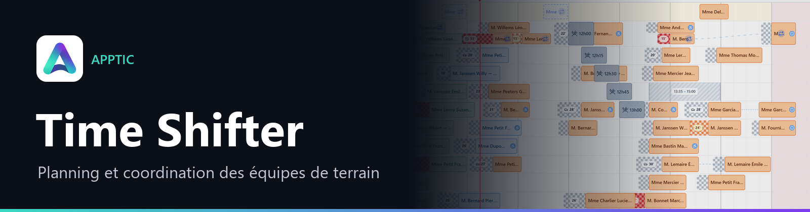
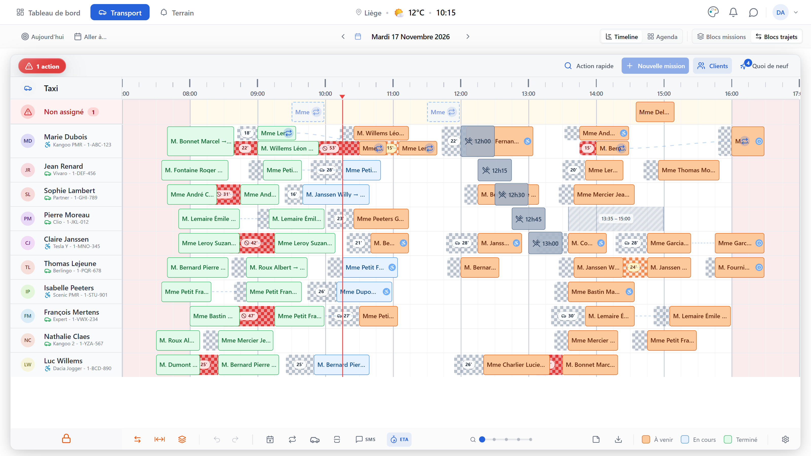
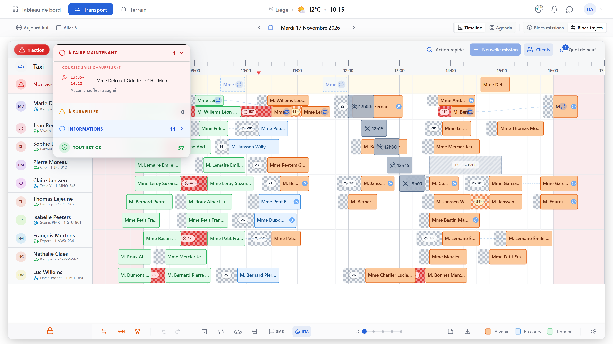
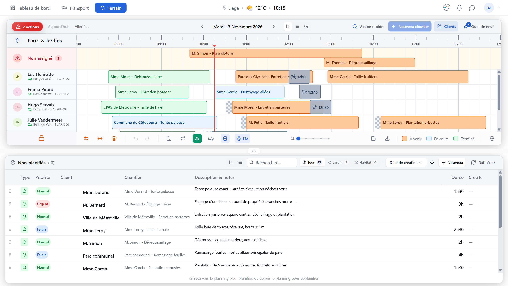
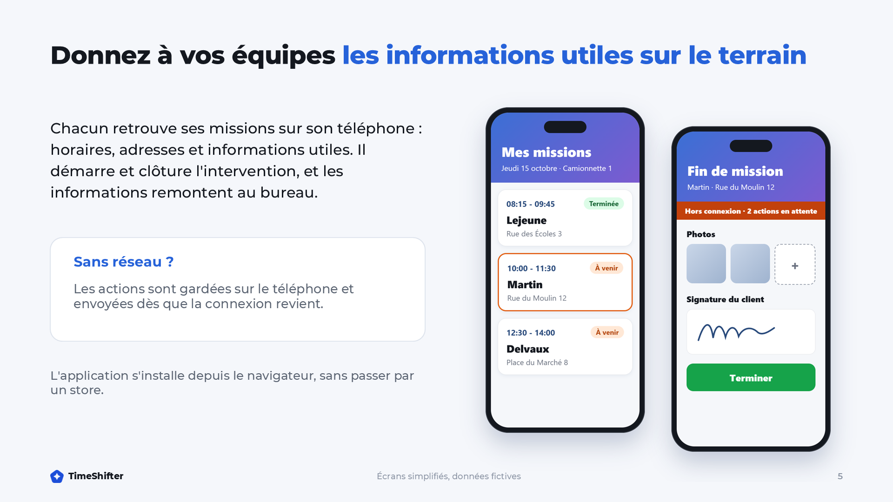
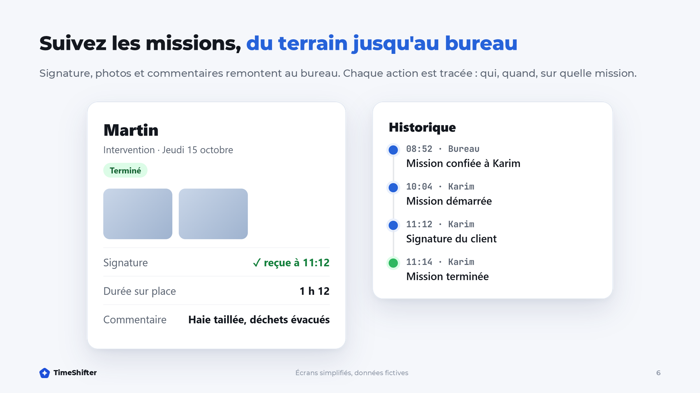
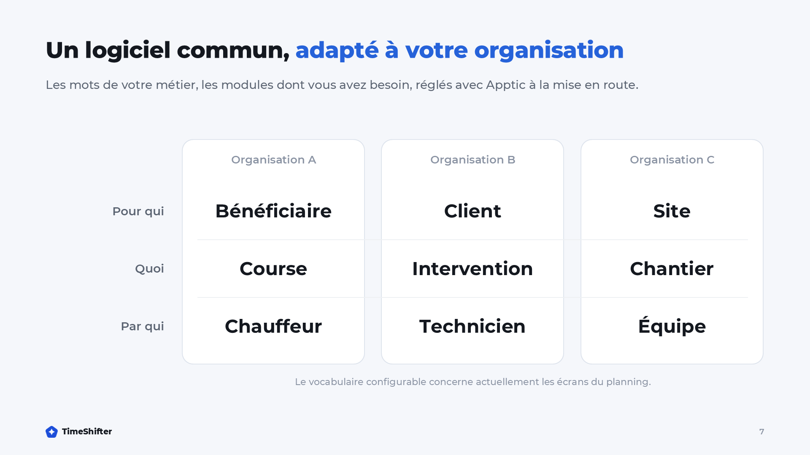
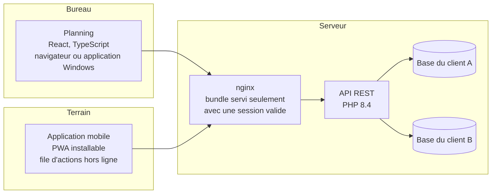

  

# Time Shifter

Un planning partagé entre le bureau et les équipes de terrain. Le dispatcheur organise la journée par personne et par véhicule ; chaque chauffeur ou ouvrier la retrouve sur son téléphone, démarre et clôture ses missions, et ce qu'il encode revient au bureau.

En production depuis mars 2026 dans un CPAS wallon, à la suite d'un marché public. Le service y organise chaque jour du transport de personnes et des chantiers d'entretien.

> Le code source de Time Shifter n'est pas publié. Ce dépôt en est la présentation.

Toutes les captures de cette page viennent du mode démonstration. Les personnes, les adresses et les organismes affichés sont fictifs.

## Le problème de départ

Un service de proximité fait rouler des chauffeurs et des équipes d'ouvriers toute la journée. Le planning tient souvent dans un tableur, un agenda papier et des coups de téléphone. Trois choses coincent alors tous les jours :

- **L'imprévu.** Un chauffeur malade à 7 h 30, un véhicule en panne, un rendez-vous médical qui déborde : il faut redistribuer la journée en quelques minutes, sans oublier personne.
- **Le terrain.** L'équipe part avec une feuille imprimée. Dès que le planning change, elle n'a plus la bonne information.
- **La fin du mois.** Kilomètres, durées, signatures : tout doit être retrouvé et recopié avant de pouvoir facturer.

## Ce que fait le logiciel

### Au bureau : la journée entière sur un écran

- Une frise par personne, avec son véhicule. Les missions se glissent d'une ligne à l'autre et se redimensionnent à la souris, par pas de 15 minutes.
- Les temps de trajet s'affichent entre deux missions. Une journée qui ne tient pas se voit avant le départ.
- Chaque déplacement s'annule et se rétablit (Ctrl+Z, Ctrl+Y). Des verrous empêchent les fausses manœuvres.
- Les absences, congés et pauses de midi bloquent la ligne de la personne concernée.
- Les activités qui reviennent chaque semaine apparaissent en blocs à confirmer d'un clic.

### L'Action Hub : ce qui reste à régler

Le planning classe lui-même les problèmes du jour : missions sans personne assignée, points à surveiller, informations. Un clic amène au bloc en cause.

### Les chantiers aussi

Le même planning sert aux équipes d'ouvriers. Les chantiers à planifier attendent dans une file sous la frise ; ils se glissent sur la journée d'une équipe, et repartent dans la file si le chantier est reporté.

### Sur le terrain : la journée dans la poche

L'application des équipes s'installe depuis le navigateur, sans passer par un store. Le chauffeur y voit ses missions, démarre, encode l'index du compteur, fait signer au doigt et clôture.

Sans réseau, le travail continue. Chaque action est gardée sur le téléphone avec son heure réelle, puis transmise dans l'ordre quand le réseau revient. Si le serveur refuse une action, par exemple parce que la mission a été modifiée entre-temps, le chauffeur le voit et peut prévenir le bureau.

  
  

Écrans simplifiés, données fictives.

### Tracé, puis prêt pour la facturation

Chaque création, modification et suppression est journalisée, avec l'état avant et après. À la fin du mois, les kilomètres, les durées et les signatures sont déjà là. Time Shifter prépare et contrôle ces éléments, puis les exporte ; la facture elle-même est émise dans le logiciel comptable de l'organisation.

### Les mots de chaque organisation

« Bénéficiaire » ou « client », « course » ou « intervention », « chauffeur » ou « technicien » : le vocabulaire du planning et les modules actifs se règlent par organisation, à la mise en route, sans développement.

  

## Architecture

Trois applications se partagent le travail : le planning du bureau, l'application mobile des équipes, et une API REST qui porte les règles métier. Chaque organisation cliente a sa propre instance : sa base de données, sa configuration, son domaine, ses modules.

Les données encodées appartiennent à l'organisation cliente. Sa base est sauvegardée chaque jour, avec une copie conservée hors du serveur.

## Choix techniques

| Choix | Raison |
|---|---|
| **Une base de données par client**, jamais de colonne « client » dans une base commune | Les données de deux organisations ne peuvent pas se mélanger, même en cas d'erreur dans une requête. Une seule base de code évolue pour tous. |
| **Le code de l'application n'est servi qu'aux personnes connectées** : nginx vérifie la session avant de livrer le moindre fichier, et la page de connexion est compilée à part | Un logiciel métier ne distribue pas son code aux inconnus. Un bundle JavaScript se télécharge sans compte si rien ne le protège. |
| **Hors ligne sur le terrain, données fraîches au bureau** : l'application mobile garde une file d'actions locale, le planning n'a volontairement aucun cache | Un chauffeur en zone blanche doit pouvoir travailler. Un dispatcheur, lui, ne doit jamais décider sur une information périmée. |
| **Moteur de planning écrit pour ce métier** : calcul des couloirs quand deux missions se chevauchent, aimantation, glisser entre deux vues, historique d'annulation | Les composants de calendrier du marché ne gèrent ni les trajets entre missions, ni les allers-retours liés, ni la ligne des missions sans personne. |
| **Les tarifs sont décidés par le serveur**, avec des barèmes datés qui ne se modifient pas dans le passé | Un montant facturable ne dépend pas de ce que le navigateur affiche. Une facture d'avril se recalcule à l'identique en novembre. |
| **Application Windows sur le même code**, empaquetée avec Tauri | Certains postes de travail préfèrent une application installée. Aucune seconde base de code à maintenir. |
| **Chaque action du terrain est rejouée avec son heure réelle** | Une course démarrée à 9 h 12 dans un village sans réseau est enregistrée à 9 h 12, pas à l'heure où le téléphone a retrouvé du signal. |

## Technologies

| Partie | Technologies |
|---|---|
| Planning | React 18, TypeScript, Vite, Tailwind CSS, Radix UI, TanStack Query, Zustand, Mapbox GL |
| Application mobile | React 18, PWA avec service worker, Dexie (IndexedDB), notifications push |
| API | PHP 8.4, MySQL 8.4, PDO sans ORM, authentification JWT |
| Application de bureau | Tauri 2 (Rust), installeurs Windows |
| Exports | Excel, PDF |
| Hébergement | VPS Linux, nginx, PHP-FPM, une instance par client |
| Tests | Vitest et Testing Library côté interfaces, scripts de contrôle côté API |

## Voir Time Shifter

- **Sur le site**, un planning simplifié se manipule directement dans la page : [timeshifter.apptic.be](https://timeshifter.apptic.be).
- **Essai de 15 jours**, sur demande, dans un espace créé pour votre organisation.
- **Démonstration en visioconférence**, sur des données fictives, avec les métiers de votre organisation.

L'application complète n'est servie qu'à des comptes connus.

- Site : [timeshifter.apptic.be](https://timeshifter.apptic.be)
- Contact : info@apptic.be

## Apptic

Time Shifter est conçu, développé et hébergé par [Apptic](https://apptic.be), studio de développement sur mesure installé à Angleur (Liège).

Autres projets : [Ligne 43](https://github.com/bastienbrasseur/apptic-ligne-43), simulateur de train dans le navigateur · [Blue Box DAW](https://github.com/bastienbrasseur/bluebox-daw-versions), logiciel de mixage multipiste · [tous les projets](https://github.com/bastienbrasseur/apptic)

---

© 2026 Apptic. Tous droits réservés. Les textes et les images de ce dépôt ne peuvent pas être réutilisés sans accord écrit. Fonds de carte : © Mapbox, © les contributeurs d'OpenStreetMap.
